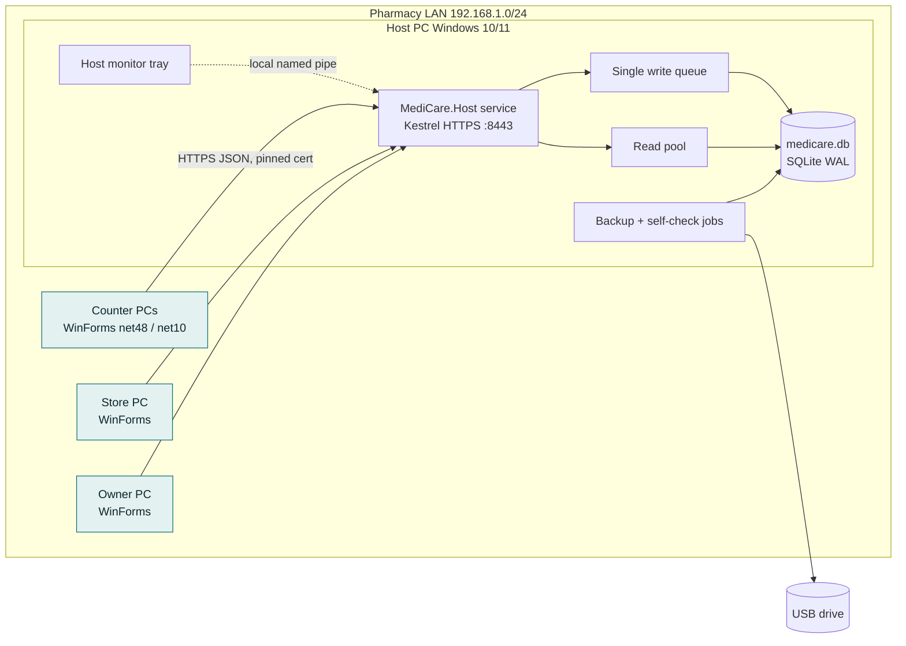

# Architecture

Decisions are recorded as ADRs in [adr/](adr/). This file is the map; the ADRs are the reasons. Data model: [data-model.md](data-model.md).

## 1. Context and constraints
- One pharmacy, one site, 7-10+ Windows PCs on a LAN, 1,000+ invoices/day, no internet ([brief](../01-idea/brief.md)).
- C# WinForms clients; SQLite on the host's local disk; clients never open the DB file (BRD s2, s10).
- Clients on Windows 7 SP1 and Windows 10/11; host on Windows 10/11 x64 (A1).
- Money in `decimal`; PKR; Pakistan Standard Time display.

## 2. Tier and stack
Tier: **Standard, on-prem** (one organisation, two deployables). See [ADR-002](adr/ADR-002-topology.md).

| Layer | Choice | Version (verify on build day) | Why | ADR |
|---|---|---|---|---|
| Host runtime | .NET 10 LTS, Windows service (`UseWindowsService`) | 10.0.x, support to Nov 2028 | LTS, Kestrel, modern crypto | ADR-002 |
| API | ASP.NET Core minimal APIs, HTTPS/1.1, JSON (System.Text.Json), long-poll events | 10.0.x | Only protocol both client runtimes speak natively | ADR-003 |
| Database | SQLite via Microsoft.Data.Sqlite + SQLitePCLRaw bundle | SQLite >= 3.51.3 | BRD mandate; single writer queue | ADR-005 |
| Data access | Dapper + hand-written SQL; own migration runner (embedded numbered `.sql`) | Dapper 2.1.x | Exact SQL for integer money and reports; no EF decimal-on-SQLite issues | ADR-005 |
| Shared code | `netstandard2.0` libraries: Contracts (DTOs), Core (pure calculations, GS1 parser, unit conversion) | - | Same maths on client preview and server | ADR-004 |
| Clients | WinForms, one project multi-targeting `net48;net10.0-windows`; PolySharp for C# features on net48 | - | Win7 + Win10/11 from one codebase | ADR-004 |
| UI kit | Own owner-drawn controls from design tokens; own GDI+ charts; `DataGridView` virtual mode | - | No third-party UI suite; identical on both runtimes | ADR-010 |
| Printing | `System.Drawing.Printing` via Windows driver; Noto Naskh Arabic for Urdu; ESC/POS only for drawer kick | - | Urdu shaping by OS; works on both runtimes | ADR-011 |
| Excel/CSV | MiniExcel on host (import + xlsx export); CSV writer on both | 1.x (Apache-2.0, verify) | Server-side only, no Office needed | ADR-005 |
| Auth | Opaque session tokens (256-bit), PBKDF2-SHA256 600k, approval PIN, server-side permission checks | - | Simple, offline, auditable | ADR-009 |
| Logging | Serilog to rolling files (host + client), redaction enricher | 4.x | Local only | - |
| Tests | xUnit with built-in asserts, Verify for report snapshots, own load harness | xUnit 2.9.x | Free licences (FluentAssertions 8 is commercially licensed, so it is not used) | - |
| Installer | Inno Setup 6.5+; host self-contained .NET 10; Win10/11 client self-contained; Win7 client needs .NET Framework 4.8 | 6.5.x | Single tool for both OS families | ADR-016 |

## 3. System view



### Solution layout
```
medicare-pharmacy/
  src/
    MediCare.Contracts/      netstandard2.0  DTOs, routes, error codes, enums
    MediCare.Core/           netstandard2.0  Money, Qty, pricing/tax calc, FEFO picker, GS1 parser, unit conversion
    MediCare.Domain/         net10.0         posting services (Sale, Purchase, Return, Adjustment, Payment...), journal rules, policies
    MediCare.Data/           net10.0         SQLite connection factory, write queue, repositories, migrations, backup
    MediCare.Host/           net10.0-windows Windows service, endpoints, auth, events, background jobs
    MediCare.HostMonitor/    net10.0-windows tray app (status, pairing fingerprint, clients)
    MediCare.Client/         net48;net10.0-windows  WinForms app: shell, screens, theme, printing, API client
  tests/
    MediCare.Core.Tests/     calculations, GS1, FEFO (runs on net48 and net10)
    MediCare.Domain.Tests/   posting rules against temp SQLite
    MediCare.Host.Tests/     API + auth + idempotency (WebApplicationFactory)
    MediCare.LoadTest/       console: N simulated counters
  installer/                 Inno Setup scripts, firewall + TLS helper scripts
  db/                        migrations/*.sql, seed/*.sql (chart of accounts, roles)
```

### Module responsibilities (host)
| Module | Responsibility |
|---|---|
| Auth & Sessions | Login, lockout, sessions, permission checks (endpoint filter), approvals tokens |
| Catalogue | Medicines, barcodes, packs, lists, import |
| Inventory | Batches, StockLedger (only writer of movements/balances), FEFO, counts, adjustments |
| Sales | POS posting, holds, returns, reprint, reversal |
| Purchasing | Purchase invoices, returns, supplier master |
| Accounts | Journal, chart of accounts, cash/bank, receipts, payments, expenses, closing |
| Reporting | Read-only queries on the read pool, export |
| Admin | Users, roles, settings, numbering, audit, backup/restore, self-check, events |

## 4. Data model
See [data-model.md](data-model.md) for the ERD and data dictionary. Key rules:
- Money is stored as INTEGER paisa (`*_paisa`). Unit costs are stored as INTEGER at 1/10,000 rupee (`*_e4`). Quantities are stored as INTEGER base units. [ADR-006](adr/ADR-006-money-and-quantity.md)
- Posted documents are immutable. Corrections are made by reversal or return. Soft deactivation applies to master data only.
- Each posting writes header + lines + stock movements + balances + journal + audit in **one** `BEGIN IMMEDIATE` transaction. [ADR-007](adr/ADR-007-ledger-and-costing.md), [ADR-008](adr/ADR-008-posting-and-numbering.md)

## 5. Authentication and authorisation
- Login → PBKDF2 verify → session row (token hash, user, workstation, created, last_seen) → token returned. Each request: `Authorization: Bearer`, plus `X-Workstation` header with the paired workstation ID. [ADR-009](adr/ADR-009-auth-sessions-approvals.md)
- Permissions are named strings (e.g. `sales.post`, `sales.discount.approve`, `stock.adjust.approve`). Roles bundle permissions; user overrides add or remove. The default matrix is in [personas.md](../01-idea/personas.md). Every endpoint declares its permission; a startup test fails if any endpoint lacks one.
- Approvals: `POST /approvals/inline` {action, payloadHash, approverUserId, pin, reason} → single-use token (5 min) → attached to the command. The server re-hashes the command and compares.
- Session idle timeout is enforced on the server too (token rejected after timeout + 1 min grace).
- No tenancy (single organisation).

## 6. API surface (v1, prefix `/api/v1`)
| Area | Endpoints (examples) |
|---|---|
| System | `GET /health`, `GET /pairing/fingerprint` (unauthenticated, shows cert hash), `GET /events?after=` (long-poll 25 s) |
| Auth | `POST /auth/login`, `POST /auth/logout`, `POST /auth/unlock`, `POST /auth/password` |
| Catalogue | `GET /medicines?q=`, `GET /medicines/by-code/{code}` (1D or GS1 raw), `POST/PUT /medicines`, `POST /imports/medicines` (multipart) → validate/dry-run/commit |
| Inventory | `GET /batches?state=`, `POST /stock/adjustments`, `POST /stock/counts`, `GET /stock/fefo?medicineId&qty` |
| Sales | `POST /sales` (Idempotency-Key), `POST /sales/{id}/reverse`, `GET /sales?…`, `POST /holds`, `GET /holds`, `POST /sales-returns` |
| Purchasing | `POST /purchases` (draft), `POST /purchases/{id}/post`, `POST /purchase-returns`, suppliers CRUD |
| Accounts | `POST /receipts`, `POST /supplier-payments`, `POST /expenses`, `POST /cash/entries`, `POST /cash/transfers`, `POST /shifts/open|close`, `POST /days/{date}/close` |
| Reports | `GET /reports/{key}?from&to&…` (JSON, paged), `GET /reports/{key}/export?format=csv|xlsx` |
| Admin | users, roles, settings, audit query, `POST /backups`, `GET /backups`, `POST /restore` (maintenance), `POST /selfcheck` |

Errors use `application/problem+json` with a stable `code` (e.g. `INSUFFICIENT_STOCK`, `BATCH_NOT_SALEABLE`, `STOCK_CHANGED`, `APPROVAL_REQUIRED`, `PERMISSION_DENIED`, `DAY_CLOSED`). Clients map codes to the UX copy in [flows.md](../02-design/flows.md).

Background jobs (host): hourly backup, daily backup + retention, nightly self-check (03:05), held-sale expiry, session cleanup, expiry state refresh at 00:00.

## 7. Non-functional targets
See PRD NFR-001…NFR-017. Summary: lookup p95 <= 300 ms, posting p95 <= 500 ms at 10 counters, daily reports <= 5 s on a 3-year dataset, RPO <= 1 h (on host) / 24 h (off host), RTO <= 60 min, WCAG 2.1 AA, 1366x768 minimum.

## 8. Security and privacy
| Threat | Control |
|---|---|
| Rogue PC on LAN calls API | TLS + login; firewall rule limited to subnet; workstation must be paired (admin-approved) |
| Man-in-the-middle | Cert fingerprint pinned at pairing; mismatch blocks |
| Password theft from DB | PBKDF2-SHA256 600k + per-user salt; PINs hashed the same way; lockout |
| Cashier bypasses UI | All rules and permissions enforced on host |
| Fraud by editing history | No update/delete on posted tables (triggers raise on UPDATE of posted rows); audit log hash chain |
| DB file copied | Host folder ACL limited to service account + Administrators; backups on USB are plain SQLite: owner told to keep the USB locked away (optional backup encryption in R1.1) |
| Logs leak secrets | Redaction enricher strips `password`, `pin`, `token`, `Authorization` |
| Windows 7 clients | No admin rights for staff accounts; TLS 1.2 enabled; documented risk ([risk.md](../01-idea/research/risk.md) R1) |

Personal data: customer name, mobile, address; prescriber and patient names for controlled drugs. Stored on host only. Export needs `reports.export`. No telemetry leaves the LAN.

## 9. Environments and deployment
| Env | Where | Data |
|---|---|---|
| Dev | Developer Windows PC + Win7 VM + Win11 VM | Seeded demo DB |
| Test/UAT | Pharmacy spare PC as host + 2 counters | Copy of imported medicine list, demo transactions |
| Production | Pharmacy host + counters | Real |

Deploy, upgrade, rollback and backup runbooks: [deployment.md](../05-production/deployment.md).

## 10. Risks and open decisions
| # | Item | Status |
|---|---|---|
| 1 | SQLite at 10+ counters: proven only after the S24 load test; fallback PostgreSQL 17 behind the same Data layer (ADR-005) | open until S24 |
| 2 | Urdu shaping on Win7 printers (Naskh default) | spike in S00 |
| 3 | 2D scanner models and GS configuration | owner input |
| 4 | Schedule B/D register exact format | owner/pharmacist input |
| 5 | Backup encryption for USB copies | deferred to R1.1 (owner decision at G6) |
| 6 | Tax treatment per medicine | owner/tax adviser |
