# Data model, ERD and data dictionary

SQLite schema (draft for S02). Conventions: [conventions.md](../04-development/conventions.md). Rules: [ADR-006](adr/ADR-006-money-and-quantity.md), [ADR-007](adr/ADR-007-ledger-and-costing.md), [ADR-008](adr/ADR-008-posting-and-numbering.md).

## Conventions
- `id INTEGER PRIMARY KEY` everywhere. Document numbers are separate unique TEXT columns.
- Money: `*_paisa INTEGER` (Rs 1.00 = 100). Unit cost or rate per base unit: `*_e4 INTEGER` (Rs 1.0000 = 10000). Percent: `*_bp INTEGER` basis points (5 % = 500).
- Quantity: `*_qty INTEGER` in base units, always.
- Time: `*_at TEXT` ISO-8601 UTC set by host (`2026-10-14T14:42:05.123Z`). Business date: `*_date TEXT` `yyyy-MM-dd` in PKT.
- Status: `status TEXT CHECK(...)`: `draft | posted | reversed` for documents.
- PRAGMAs per connection: `foreign_keys=ON`, `journal_mode=WAL`, `synchronous=FULL`, `busy_timeout=5000`, `temp_store=MEMORY`.
- Posted rows are protected by triggers: `BEFORE UPDATE ... WHEN OLD.status='posted' AND NEW.status NOT IN ('reversed')` → `RAISE(ABORT,'posted rows are immutable')`, and `BEFORE DELETE` on all document, movement, journal and audit tables → ABORT.

## ERD (core)

```mermaid
erDiagram
  users ||--o{ user_roles : has
  roles ||--o{ user_roles : grants
  roles ||--o{ role_permissions : includes
  users ||--o{ user_permission_overrides : has
  users ||--o{ sessions : opens
  workstations ||--o{ sessions : from

  medicines ||--o{ medicine_packs : "pack levels"
  medicines ||--o{ barcodes : "identified by"
  medicine_packs ||--o{ barcodes : "per level"
  manufacturers ||--o{ medicines : makes
  categories ||--o{ medicines : groups
  medicines ||--o{ batches : "stocked as"
  medicines ||--|| medicine_costs : "avg cost"
  batches ||--o{ stock_balances : "per state"
  batches ||--o{ stock_movements : "changed by"

  suppliers ||--o{ purchase_headers : bills
  purchase_headers ||--o{ purchase_items : lines
  purchase_items }o--|| batches : "creates/adds"
  purchase_headers ||--o{ purchase_return_headers : "returned via"
  purchase_return_headers ||--o{ purchase_return_items : lines

  customers ||--o{ sales_headers : buys
  sales_headers ||--o{ sales_items : lines
  sales_items }o--|| batches : "taken from"
  sales_headers ||--o{ sales_payments : "paid by"
  sales_headers ||--o{ sales_return_headers : "returned via"
  sales_return_headers ||--o{ sales_return_items : lines
  sales_items ||--o| prescriptions : "Rx for"

  customers ||--o{ customer_receipts : pays
  customer_receipts ||--o{ receipt_allocations : allocates
  suppliers ||--o{ supplier_payments : paid
  supplier_payments ||--o{ payment_allocations : allocates

  accounts ||--o{ journal_lines : posts
  journal_entries ||--o{ journal_lines : contains
  cash_accounts ||--|| accounts : "is ledger"
  cash_accounts ||--o{ cash_transactions : moves
  expenses }o--|| cash_accounts : "paid from"

  stock_adjustments ||--o{ stock_adjustment_items : lines
  stock_counts ||--o{ stock_count_items : lines
  shifts ||--o{ shift_counts : denominations
  approvals }o--|| users : "approved by"
  audit_logs }o--|| users : "by"
```

Every document table (sales, purchases, returns, receipts, payments, expenses, adjustments, cash entries, shifts) carries `journal_entry_id` and, where stock moves, the movements carry `source_type` + `source_line_id`.

## Data dictionary (key tables)

### Identity and access
| Table | Key columns | Notes |
|---|---|---|
| users | id, username UNIQUE COLLATE NOCASE, full_name, pwd_hash, pwd_salt, pwd_iter, pin_hash, pin_salt, must_change_pwd, is_active, failed_count, locked_until_at, session_timeout_min, last_login_at | No delete; deactivate |
| roles / role_permissions | role(id, name), role_permissions(role_id, permission) | Seeded: Administrator, Manager, Cashier, Accountant, Stock |
| user_permission_overrides | user_id, permission, grant (1/0) | Override beats role |
| workstations | id, name, machine_guid UNIQUE, os, client_version, paired_by, paired_at, is_active | Admin approves pairing |
| sessions | id, token_hash UNIQUE, user_id, workstation_id, created_at, last_seen_at, revoked_at | Token never stored in clear |
| approvals | id, action, payload_hash, requester_id, approver_id, reason, workstation_id, status (pending/approved/rejected/used/expired), created_at, decided_at, used_at | Single-use |

### Catalogue
| Table | Key columns | Notes |
|---|---|---|
| medicines | id, code UNIQUE (`M-00087`), name, generic, brand, manufacturer_id, category_id, dosage_form, strength, base_unit, purchase_pack_id, default_sale_pack_id, default_purchase_e4 (per base unit), default_sale_paisa (per default sale pack), min_stock_qty, tax_bp, tax_inclusive, rx_required, schedule (NULL/B/D/G), urdu_name, is_active, created_at, updated_at | Search index: FTS5 table `medicine_search(name, generic, brand, manufacturer)` |
| medicine_packs | id, medicine_id, name (Box/Strip/Tablet/Bottle), base_qty INTEGER > 0, is_sellable, sale_paisa | UNIQUE(medicine_id, name); base pack has base_qty = 1 |
| barcodes | id, code UNIQUE, medicine_id, pack_id, kind (EAN13/UPC/GTIN14/INTERNAL) | GTIN-14 normalised (leading zero kept) |
| manufacturers, categories, dosage_forms | id, name UNIQUE, is_active | Configurable lists |
| medicine_costs | medicine_id PK, avg_cost_e4, qty_on_hand (all states), updated_at | Moving average per base unit (ADR-007) |
| price_history | id, medicine_id, pack_id, old_paisa, new_paisa, changed_by, changed_at, reason | Also in audit |

### Inventory
| Table | Key columns | Notes |
|---|---|---|
| batches | id, medicine_id, batch_no, expiry_date, mfg_date, supplier_id, first_purchase_item_id, purchase_e4, sale_paisa, mrp_paisa, rack, created_at | UNIQUE(medicine_id, batch_no, expiry_date); CHECK(mfg_date IS NULL OR expiry_date >= mfg_date) |
| stock_balances | batch_id, state (saleable/quarantine), qty CHECK(qty >= 0) | PK(batch_id, state). Expired = derived from expiry_date |
| stock_movements | id, batch_id, state, qty_delta, source_type (PI/PIR/SI/SR/PR/SA/SC/WO/REV/OPEN), source_id, source_line_id, cost_e4, at, user_id | Immutable. Index (batch_id, at), (source_type, source_id) |
| stock_adjustments / _items | header(no, date, reason, status, created_by, approval_id, journal_entry_id); item(batch_id, state, system_qty, physical_qty, diff_qty, value_paisa, notes) | |
| stock_counts / _items | count(no, scope, frozen_at, status); item(batch_id, frozen_qty, counted_qty) | Diff at post = counted − (frozen + movements since) |

### Purchasing
| Table | Key columns | Notes |
|---|---|---|
| suppliers | id, code UNIQUE, name, contact, mobile, address, tax_no, terms_days, is_active, notes | Opening balance via journal `OPEN` |
| purchase_headers | id, no UNIQUE NULL (until posted), supplier_id, supplier_inv_no, inv_date, due_date, status, gross_paisa, disc_paisa, tax_paisa, charges_paisa, net_paisa, paid_paisa, notes, posted_at, posted_by, journal_entry_id, reverses_id | UNIQUE(supplier_id, supplier_inv_no) when posted |
| purchase_items | id, header_id, medicine_id, pack_id, batch_no, expiry_date, mfg_date, qty_packs, free_packs, base_qty, free_base_qty, rate_paisa (per pack), disc_bp, tax_bp, net_paisa, unit_cost_e4 (effective, per base unit), mrp_paisa, sale_paisa, batch_id, capture_method (2D/1D/SEARCH) | |
| purchase_return_headers / _items | header(no, purchase_id, supplier_id, credit_note_ref, status, amount_paisa, journal_entry_id); item(purchase_item_id, batch_id, state, qty, unit_cost_e4, amount_paisa, reason) | |

### Sales
| Table | Key columns | Notes |
|---|---|---|
| customers | id, code UNIQUE, name, mobile (normalised digits) , address, type (WALKIN/REGULAR/CREDIT), credit_limit_paisa, is_active | `C-0001` Walk-in seeded, immutable |
| sales_headers | id, no UNIQUE, idempotency_key UNIQUE, counter_no, workstation_id, cashier_id, customer_id, sold_at, business_date, gross_paisa, line_disc_paisa, inv_disc_paisa, tax_paisa, net_paisa, credit_paisa, status, journal_entry_id, discount_approval_id, reverses_id | Snapshot only; no FKs to price tables |
| sales_items | id, header_id, line_no, medicine_id, batch_id, pack_id, pack_base_qty, base_qty, rate_paisa (per pack), gross_paisa, disc_paisa, tax_bp, tax_paisa, net_paisa, cost_e4 (avg at sale), cogs_paisa, pick (FEFO/2D/MANUAL) | A FEFO split creates one row per batch |
| sales_payments | id, header_id, method (CASH/CARD/WALLET/BANK/CREDIT), cash_account_id, amount_paisa, tendered_paisa, change_paisa, reference | Sum = net |
| prescriptions | id, sales_item_id, prescriber, prescriber_reg, patient, rx_no, register_serial | Feeds controlled register |
| holds | id, counter_no, workstation_id, user_id, customer_id, payload_json, created_at, expires_at | Not a document |
| sales_return_headers / _items | header(no, sale_id, refund_method, refund_paisa, approval_id, status, journal_entry_id); item(sales_item_id, batch_id, qty, outcome RESTOCK/QUARANTINE, reason, refund_paisa, cost_e4) | |

### Accounts
| Table | Key columns | Notes |
|---|---|---|
| accounts | id, code UNIQUE, name, type (ASSET/LIABILITY/EQUITY/INCOME/EXPENSE), parent_id, is_system | Seeded chart (below) |
| journal_entries | id, no UNIQUE, entry_date, source_type, source_id, memo, posted_at, posted_by, reverses_id | CHECK via trigger: SUM(debit) = SUM(credit) at commit (deferred check in posting service + self-check) |
| journal_lines | id, entry_id, account_id, debit_paisa, credit_paisa, party_type (CUSTOMER/SUPPLIER/NULL), party_id | Ledgers = filters on this table |
| cash_accounts | id, account_id UNIQUE, name, kind (CASH/BANK/CARD/WALLET), enforce_balance | |
| cash_transactions | id, cash_account_id, at, amount_paisa (signed), source_type, source_id, memo | Derived rows written by postings; never typed twice |
| customer_receipts / receipt_allocations | receipt(no, customer_id, amount_paisa, method, cash_account_id, ref, journal_entry_id); alloc(receipt_id, sales_header_id, amount_paisa) | |
| supplier_payments / payment_allocations | payment(no, supplier_id, amount_paisa, cash_account_id, ref, journal_entry_id); alloc(payment_id, purchase_header_id, amount_paisa) | |
| expenses | id, no, date, category_id, description, amount_paisa, cash_account_id, ref, entered_by, approval_id, journal_entry_id | |
| shifts / shift_counts | shift(id, workstation_id, user_id, opened_at, float_paisa, closed_at, expected_paisa, counted_paisa, diff_paisa, reason, approval_id); counts(shift_id, denomination, count) | |
| day_closings | business_date PK, closed_at, closed_by | Closed dates need approval to post into |

**Seeded chart of accounts (codes):** 1000 Cash in hand · 1010 Bank accounts (children per bank) · 1020 Card settlement · 1030 Wallets · 1100 Customer receivables · 1200 Inventory (saleable) · 1210 Inventory (quarantine) · 2000 Supplier payables · 2100 Customer advances · 2200 Sales tax payable · 3000 Owner's equity · 3100 Opening balance equity · 4000 Sales · 4010 Sales returns (contra) · 4020 Sales discounts (contra) · 5000 COGS · 5010 Inventory write-offs and shrinkage · 5020 Purchase price variance (rounding) · 6000+ Operating expenses (one child per expense category) · 6900 Cash over/short.

### Platform
| Table | Key columns | Notes |
|---|---|---|
| doc_sequences | series, period_key, next_seq | PK(series, period_key); incremented inside the posting transaction |
| idempotency_keys | key PK, endpoint, request_hash, response_json, created_at | Kept 30 days |
| app_settings | key PK, value_json, updated_by, updated_at | Typed via config module |
| audit_logs | id, at, user_id, workstation_id, action, module, record_ref, before_json, after_json, reason, approval_id, prev_hash, hash | Hash chain: hash = SHA256(prev_hash ‖ row data) |
| backup_history | id, kind (HOURLY/DAILY/USB/SAFETY), path, size_bytes, sha256, schema_version, started_at, finished_at, result, check_result, message | |
| selfcheck_runs | id, at, result, details_json | |
| import_jobs | id, file_name, rows, created, skipped, status, created_by, at, undo_available | |
| schema_version | version, applied_at, checksum | Migration runner |
| events | seq PK, at, type, payload_json, audience | Long-poll source; pruned after 1 day |

## Journal postings (reference)
| Document | Debit | Credit |
|---|---|---|
| Sale | 1000/1010/1020/1030 per tender (net payable) ; 1100 Receivables (credit part, party) ; 4020 Sales discounts (line + invoice discounts) | 4000 Sales (gross, excluding tax) ; 2200 Tax payable |
| Sale COGS | 5000 COGS | 1200 Inventory |
| Sales return | 4010 Returns; 1200 Inventory (restock) or 1210 (quarantine) at original cost | Cash/Bank/1100 Receivable; 5000 COGS |
| Purchase posted | 1200 Inventory (effective cost) ; 2200 Tax (if claimable) | 2000 Payables (party); rounding to 5020 |
| Purchase immediate payment / supplier payment | 2000 Payables | 1000/1010 |
| Purchase return | 2000 Payables | 1200/1210 Inventory |
| Customer receipt | 1000/1010 | 1100 Receivables |
| Expense | 6xxx | 1000/1010 |
| Adjustment (shortage/damage) | 5010 Shrinkage | 1200 Inventory |
| Move to quarantine | 1210 | 1200 |
| Write-off quarantine | 5010 | 1210 |
| Cash difference | 6900 Cash over/short | 1000 Cash (short), or reversed (over) |
| Opening balances | 1100 / 1200 / 1000 (customer dues, stock, cash) ; 3100 for supplier balances | 3100 Opening balance equity ; 2000 Payables (supplier balances) |
